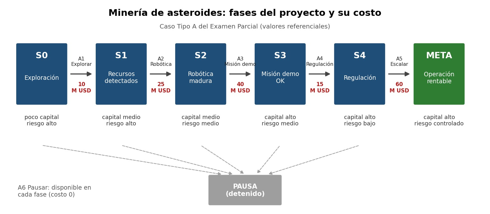

Challenge 2 : 

Caso asignado : Minería de Asteroides

Dato	Detalle
Universidad	Universidad Peruana Cayetano Heredia
Curso	Machine Learning
Docente	Yannick Patrick Carrasco Merma
Unidad	Fundamentos de Machine Learning (N° de Unidad 2)
Estudiante	Javier Crhistofherd Silva Salinas

Minería de Asteroides

## 1. Presentación del caso

La minería de asteroides consiste en extraer recursos (metales, agua, etc.) de cuerpos rocosos del espacio. Hoy es un negocio que todavía no es rentable de forma inmediata: exige invertir mucho dinero, por etapas, mientras la tecnología madura y la regulación se aclara.

En el caso del Examen Parcial, un proyecto de este tipo arranca en **exploración**, con **poco capital** y **riesgo alto**. Para llegar a una **operación rentable** debe pasar por varias fases, y cada una cuesta dinero:

1. Explorar y detectar recursos.
2. Desarrollar robótica madura.
3. Hacer una misión demostrativa.
4. Cumplir con la regulación.
5. Escalar la operación.

En cualquier fase, la empresa también puede **pausar** el proyecto para no seguir gastando.

*Figura 1. Fases del proyecto con su costo referencial en millones de USD *

## 2. Problema que se desea resolver

> **¿En qué orden y con cuánta inversión conviene avanzar fase por fase para llevar un proyecto de minería de asteroides desde la exploración hasta una operación rentable, gastando lo mínimo posible, y qué retorno se puede esperar según el capital invertido?**

Dicho de forma más corta, son dos preguntas conectadas:

- **Pregunta de decisión:** ¿cuál es la ruta más barata para llegar a la meta? (se resuelve con búsqueda)
- **Pregunta de predicción:** ¿cuánto retorno esperar si invertimos cierto capital? (se resuelve con regresión)

## 3. ¿Por qué se puede abordar con IA y Machine Learning?

**a) Es un problema de decisiones en secuencia.**
Cada fase deja al proyecto en un estado distinto (fase tecnológica, capital y riesgo) y cada decisión lo lleva a otro. Eso se puede modelar como un espacio de estados y resolver con algoritmos de búsqueda de IA como BFS y A*. A* además usa una heurística (el costo estimado que falta hasta la meta), así que explora menos caminos que una búsqueda a ciegas.

**b) Equivocarse sale caro.**
Cada fase cuesta millones de dólares. Un algoritmo que compara rutas y costos de forma sistemática es más confiable que decidir "a ojo", sobre todo cuando el problema crece y aparecen más fases o más ramas.

**c) El retorno depende del capital y no se conoce de antemano.**
No tenemos una fórmula exacta, pero sí podemos aprender la relación entre capital invertido y retorno esperado a partir de datos. Eso es aprendizaje supervisado (regresión): con el modelo entrenado se puede predecir el retorno para montos que no están en el grafo.

**d) Limitación que reconocemos.**
No existen datos históricos masivos de minería de asteroides. Por eso el modelo de predicción usa **datos sintéticos o referenciales** construidos a partir del caso. Sirve para demostrar el pipeline y razonar sobre el problema, pero **no** para tomar decisiones reales de inversión.

