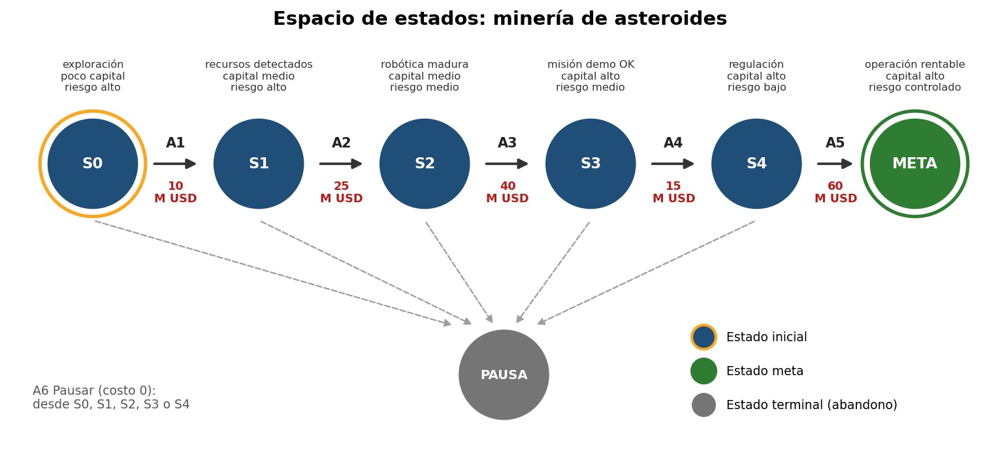

# Espacio de Estados: Minería de Asteroides

**Caso:** Tipo A del Examen Parcial · **Curso:** Machine Learning (Unidad 2)

El objetivo de este documento es representar formalmente el problema planteado en el [README](README.md): llevar un proyecto de minería de asteroides desde la exploración hasta una operación rentable, gastando lo mínimo posible. Aquí definimos los **estados**, los **operadores** y las **restricciones**, y los mostramos de forma visual.

---

## 1. Modelo conceptual

Un estado describe en qué situación está el proyecto en un momento dado. Lo representamos con una tupla de tres componentes:

```
S = (fase tecnológica, capital, riesgo)
```

- **Fase tecnológica:** qué tan avanzado está el proyecto (exploración, robótica, misión demo, etc.).
- **Capital:** cuánto dinero tiene comprometido el proyecto (poco, medio o alto).
- **Riesgo:** qué tan expuesto está (alto, medio, bajo o controlado).

Cada decisión de inversión es un operador que lleva de un estado a otro y tiene un costo en millones de USD.

## 2. Estados

| Estado | Fase tecnológica | Capital | Riesgo | Capital acumulado (M USD) | Tipo |
|---|---|---|---|---|---|
| S0 | exploración | poco capital | riesgo alto | 0 | **Inicial** |
| S1 | recursos detectados | capital medio | riesgo alto | 10 | Intermedio |
| S2 | robótica madura | capital medio | riesgo medio | 35 | Intermedio |
| S3 | misión demo OK | capital alto | riesgo medio | 75 | Intermedio |
| S4 | regulación | capital alto | riesgo bajo | 90 | Intermedio |
| META | operación rentable | capital alto | riesgo controlado | 150 | **Meta** |
| PAUSA | detenido | - | - | (depende de dónde se pause) | Terminal (fracaso o abandono) |

> La columna de capital acumulado es la suma de los costos del camino recorrido. Es la misma que usaremos después como variable de entrada en el modelo de predicción (Rubro 4).

**Estado inicial:** `S0`.
**Estado meta:** `META`.

## 3. Operadores

| Operador | Acción | Precondición (estado en que se aplica) | Efecto (nuevo estado) | Costo (M USD) |
|---|---|---|---|---|
| A1 | Explorar | S0 | S1 | 10 |
| A2 | Desarrollar robótica | S1 | S2 | 25 |
| A3 | Misión demostrativa | S2 | S3 | 40 |
| A4 | Cumplir regulación | S3 | S4 | 15 |
| A5 | Escalar la operación | S4 | META | 60 |
| A6 | Pausar el proyecto | S0, S1, S2, S3 o S4 | PAUSA | 0 |

Como función de transición, esto se escribe así: `δ(S0, A1) = S1`, `δ(S1, A2) = S2`, `δ(S2, A3) = S3`, `δ(S3, A4) = S4`, `δ(S4, A5) = META` y `δ(Sk, A6) = PAUSA` para k = 0 a 4.

## 4. Restricciones

1. **Orden obligatorio:** las fases no se pueden saltar. Un operador solo se puede aplicar si el proyecto está en su estado de precondición (por ejemplo, no se puede escalar sin haber cumplido la regulación).
2. **Costos no negativos:** cada operador cuesta 0 o más millones de USD, y el costo de una ruta es la suma de los costos de sus operadores.
3. **Estados terminales:** `META` y `PAUSA` no tienen operadores de salida. Una vez que se llega a uno de ellos, el proyecto no continúa.
4. **Pausar es una decisión definitiva:** desde `PAUSA` no se puede volver a ninguna fase anterior.
5. **Sin retrocesos:** no existen operadores que regresen a una fase anterior (el espacio no tiene ciclos).

## 5. Costo de ruta y heurística

El **costo de una ruta** `g` es la suma de los costos de los operadores aplicados. Para guiar la búsqueda informada (A*) usamos una **heurística** `h(n)`: el costo estimado que falta desde el estado `n` hasta la meta.

| Estado | h(n) estimado | Costo real que falta h*(n) | ¿h(n) ≤ h*(n)? |
|---|---|---|---|
| S0 | 140 | 150 | Sí |
| S1 | 130 | 140 | Sí |
| S2 | 100 | 115 | Sí |
| S3 | 70 | 75 | Sí |
| S4 | 55 | 60 | Sí |
| META | 0 | 0 | Sí |
| PAUSA | 999 | no llega a la meta | Se usa un valor muy alto para descartarlo |

Como `h(n)` nunca sobreestima el costo real que falta, la heurística es **admisible**, y eso garantiza que A* encuentre la ruta de menor costo.

## 6. Representación visual



*Figura 2. Grafo del espacio de estados: nodos (estados), aristas (operadores con su costo en M USD), estado inicial, meta y estado terminal PAUSA.*

## 7. Tamaño del espacio y observaciones

- El espacio tiene **7 estados** y **10 transiciones** (5 de avance y 5 hacia `PAUSA`).
- Existe **un único camino** a la meta: `S0 → S1 → S2 → S3 → S4 → META`, con 5 operadores y un costo total de **150 M USD**.
- Es un espacio pequeño, pensado para poder razonarlo y verificarlo a mano. Si el modelo creciera (más fases, rutas alternativas o varios proyectos a la vez), la búsqueda informada con heurística sería la que evitaría explorar todas las combinaciones.

---

Los algoritmos de búsqueda (BFS y A*) que recorren este espacio se implementan en `01_pipeline_busqueda.ipynb` (Rubro 3).
